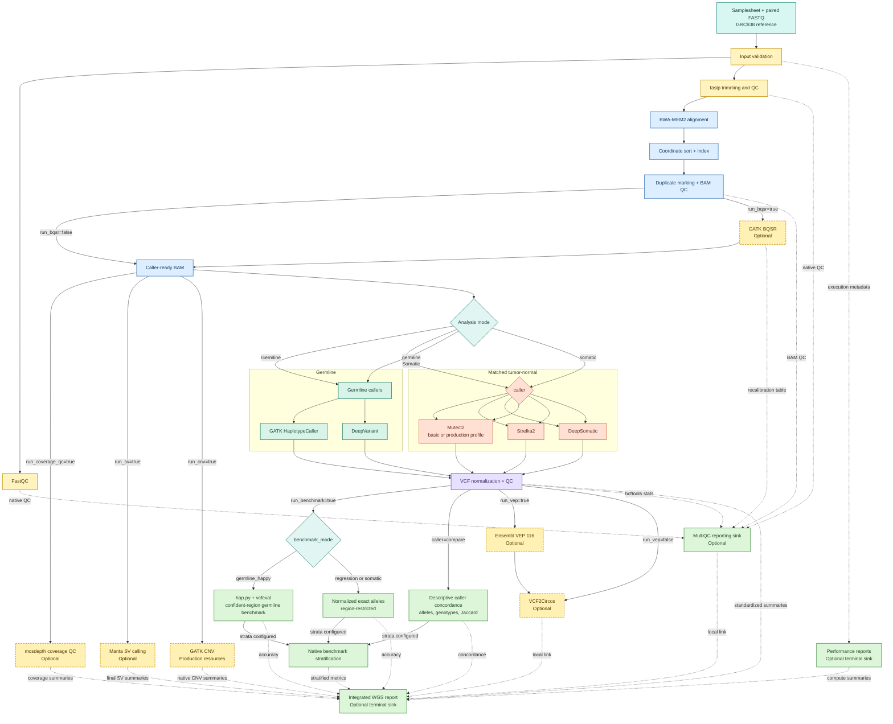
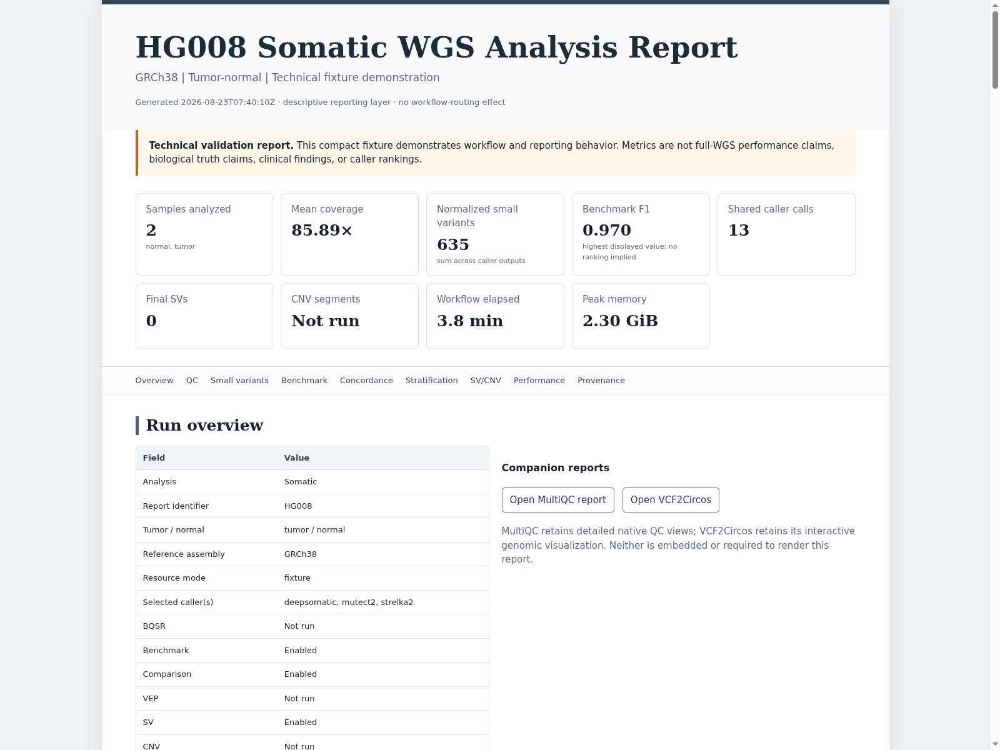
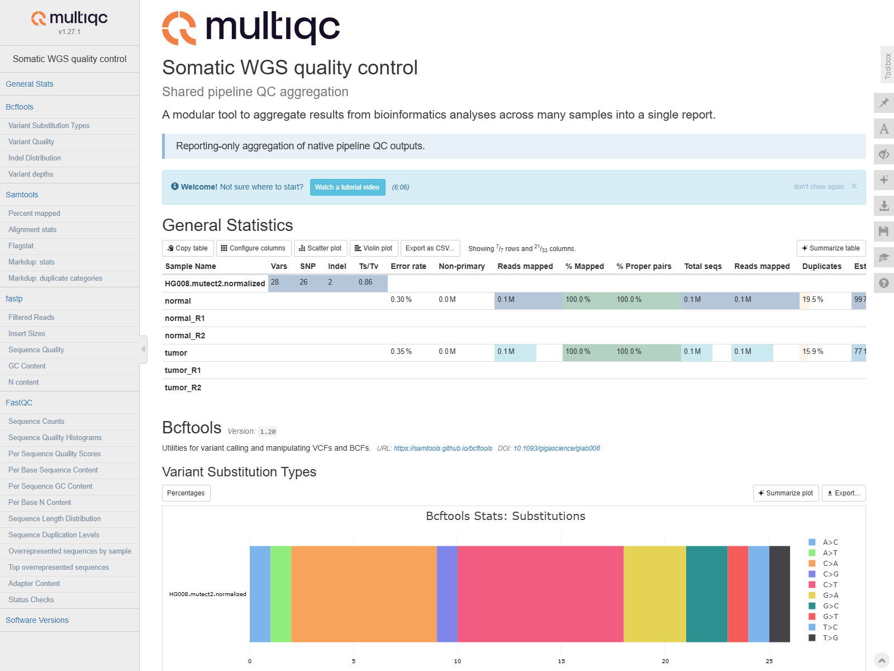
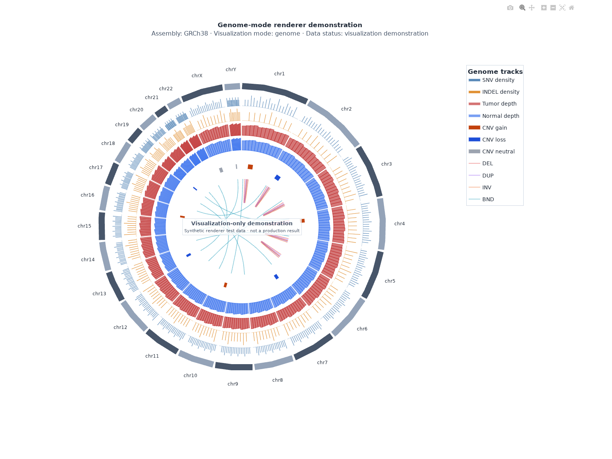
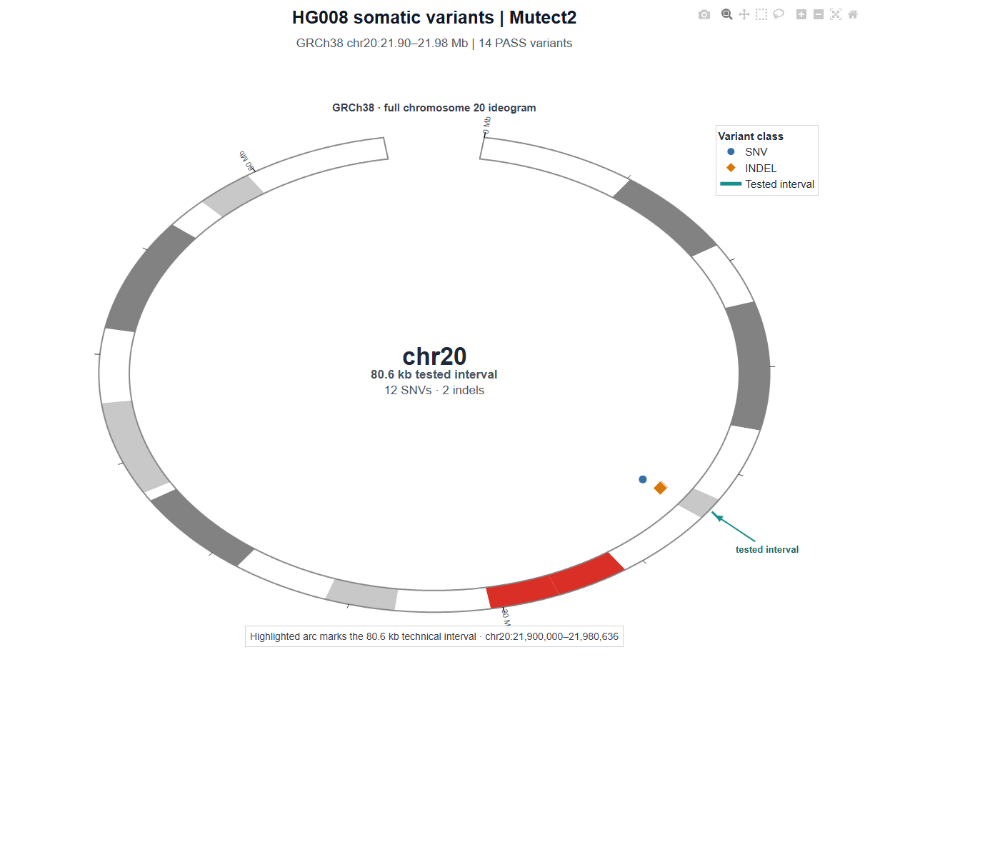

# WGS Variant Analysis Pipeline


[](LICENSE)

A reproducible Nextflow DSL2 workflow for short-read human WGS analysis. In addition to its established germline and matched tumor-normal small-variant framework, it provides optional Manta structural variants, production-resource-backed GATK CNV workflows, and mosdepth genome/region coverage QC. These modalities fan out from the same caller-ready BAMs and do not alter small-variant calling, benchmarking, concordance, stratification, or performance semantics.

When `--calling_interval` is omitted, callers operate across the supplied reference. The bundled data are real, compact GRCh38 chromosome 20 technical fixtures, so their validation commands explicitly select the matching chr20 intervals. These fixtures support fast technical testing and are not full whole-genome datasets.

## Workflow



MultiQC and the integrated analysis report are reporting sinks. They aggregate or summarize derived outputs but do not modify reads, BAMs, calls, annotations, benchmarks, concordance, stratification, SV/CNV results, or visualizations.

### Analysis capabilities

| Analysis component | Implementation |
|---|---|
| Read QC and preprocessing | FastQC, fastp |
| Alignment | BWA-MEM2 |
| Alignment post-processing | Coordinate sorting, BAM indexing, duplicate marking |
| Base quality recalibration | GATK BQSR (optional) |
| Germline small variants | GATK HaplotypeCaller, DeepVariant |
| Somatic small variants | Mutect2, Strelka2, DeepSomatic |
| Germline benchmarking | hap.py with RTG vcfeval |
| Somatic benchmarking | Normalized PASS-allele comparison |
| Caller concordance | Allele overlap, Jaccard similarity, and germline genotype concordance |
| Stratified evaluation | GIAB/GA4GH-compatible genomic stratifications |
| Coverage QC | mosdepth |
| Structural variants | Manta |
| Copy-number analysis | GATK CNV |
| Variant annotation | Ensembl VEP 116 |
| Visualization and QC reporting | MultiQC, VCF2Circos |
| Integrated reporting | Offline HTML analysis report with benchmark, concordance, coverage, performance, and provenance summaries |
| Execution | Docker locally; SLURM with Apptainer or Singularity profiles |

> **Scope note:** Small-variant calling, benchmarking, caller comparison, stratification, coverage QC, and reporting are validated using the bundled compact regression fixtures. Manta structural-variant calling is integrated and validated for workflow execution and valid empty-callset handling. GATK CNV workflows are implemented for production use but require compatible study-specific models, intervals, and/or panels of normals and are therefore not biologically validated using the compact fixtures. Full-genome accuracy, SV/CNV sensitivity, sex-chromosome behavior, and production-scale performance require external GRCh38 resources and full-WGS validation.


## Features

- Validates paired-end FASTQ samplesheets, analysis modes, caller compatibility, reference availability, and optional BQSR resources.
- Runs FastQC on each input read file and fastp for paired-end trimming and QC.
- Aligns reads with BWA-MEM2, coordinate-sorts and indexes BAMs, marks duplicates, and generates samtools QC.
- Routes duplicate-marked or recalibrated BAMs through one standardized caller-ready contract.
- Selects one caller per run or deliberately fans the same caller-ready BAM(s) to the complete compatible caller set with `--caller compare`.
- Emits either a direct HaplotypeCaller VCF or a standard indexed GVCF followed by GenotypeGVCFs; only the final diploid VCF enters shared downstream processing.
- Offers an opt-in production Mutect2 profile with external population/PoN resources, F1R2 orientation modeling, matched-normal contamination estimation, and resource-aware FilterMutectCalls.
- Preserves native caller VCFs and creates normalized, split, bgzipped, indexed VCFs with bcftools statistics and a compact summary TSV.
- Optionally benchmarks the final normalized VCF: hap.py/vcfeval for region-restricted germline evaluation, or an explicit normalized allele engine for fixture regression and somatic PASS calls. User-supplied BED strata add independent genomic-context summaries without changing the aggregate table.
- Optionally produces neutral multi-caller membership, caller-specific/shared sets, pairwise Jaccard values, germline genotype concordance, truth-overlap descriptions, and standards-compliant derivative VCFs without constructing a consensus. Stratified derivatives retain the same membership semantics.
- Optionally annotates normalized VCFs with Ensembl VEP 116.
- Optionally creates an interactive VCF2Circos HTML from the VEP VCF when available, otherwise from the normalized VCF.
- Optionally aggregates native QC artifacts with MultiQC.
- Optionally renders a compact, self-contained offline HTML report from standardized outputs, with publication-preview SVG figures and relative links to MultiQC and VCF2Circos.

### Caller-ready BAM routing

| Setting | BAM consumed by the selected caller |
|---|---|
| `--run_bqsr false` | `<sample>.markdup.bam` |
| `--run_bqsr true` | `<sample>.recal.bam` |

## Supported analysis modes

| `analysis_type` | Allowed `caller` values | Input roles |
|---|---|---|
| `germline` | `haplotypecaller`, `deepvariant`, `compare` | one or more rows with role `sample` |
| `somatic` | `mutect2`, `strelka2`, `deepsomatic`, `compare` | exactly one `tumor` and one `normal` row per patient |

Caller selection is explicit through `--analysis_type` and `--caller`. `compare` means HaplotypeCaller plus DeepVariant for germline, or Mutect2 plus Strelka2 plus DeepSomatic for somatic. The workflow rejects incompatible combinations and otherwise does not schedule unselected callers.

## Requirements

- Nextflow with DSL2 support
- Docker with permission to run containers for local execution, or Apptainer/Singularity plus a SLURM client on HPC
- Python 3 on the Nextflow driver host when performance reporting is enabled
- Sufficient storage for workflow outputs, Nextflow work files, and container images

Individual bioinformatics tools do not need to be installed on the host. The Docker profile uses pinned images, which Nextflow downloads automatically when they are missing. The first run can require substantial time and storage because official caller and annotation images are large.

The included local profile is intentionally conservative: one CPU per process, `maxForks = 1`, a queue size of one, and process memory requests from 512 MB to 2.5 GB.

## Quick Start

Clone or otherwise obtain the repository, change into its root directory, and confirm that `nextflow` and `docker` are available. A compact germline technical test is:

```bash
git clone <repository-url>
cd wgs-pipeline
nextflow run . -profile docker \
  --resource_mode fixture \
  --analysis_type germline \
  --caller haplotypecaller \
  --input test_data/germline/samplesheet.tsv \
  --reference test_data/reference/GRCh38_chr20.fa.gz \
  --calling_interval chr20:12446968-12455543 \
  --run_analysis_report true \
  --outdir results/quickstart-germline
```

For the matched tumor-normal fixture, use:

```bash
nextflow run . -profile docker \
  --resource_mode fixture \
  --analysis_type somatic \
  --caller mutect2 \
  --input test_data/somatic/samplesheet.tsv \
  --reference test_data/reference/GRCh38_chr20.fa.gz \
  --calling_interval chr20:21900000-21980636 \
  --run_analysis_report true \
  --outdir results/quickstart-somatic
```

Published results appear below the selected `--outdir`; the optional integrated report is written below its `report/` directory. These fixture commands exercise compact chromosome 20 data only and are not full-WGS validation runs.

## Inputs

### Samplesheet

The input is a tab-delimited file with exactly these columns:

```text
sample_id	patient_id	role	fastq_r1	fastq_r2
```

Relative FASTQ paths are resolved from the samplesheet directory. Absolute paths are accepted, but portable samplesheets should use relative paths.

Germline example, matching `test_data/germline/samplesheet.tsv`:

```text
sample_id	patient_id	role	fastq_r1	fastq_r2
HG002	HG002	sample	HG002_R1.fastq.gz	HG002_R2.fastq.gz
```

Somatic example, matching `test_data/somatic/samplesheet.tsv`:

```text
sample_id	patient_id	role	fastq_r1	fastq_r2
normal	HG008	normal	normal_R1.fastq.gz	normal_R2.fastq.gz
tumor	HG008	tumor	tumor_R1.fastq.gz	tumor_R2.fastq.gz
```

### Reference and resource modes

`--resource_mode fixture` is the default so existing repository regression commands remain usable. It uses the compact `test_data/reference/GRCh38_chr20.fa.gz` source and the bundled fixture manifest. One shared preparation path decompresses that small FASTA and creates its FAI, sequence dictionary, and BWA-MEM2 index once per fixture workflow. These chr20 assets are only for regression testing, development, examples, and fast technical validation.

`--resource_mode production` requires an external, reusable resource bundle. It never falls back to the bundled reference or known-sites VCF, and it never builds a BWA-MEM2 index. The external FASTA must be uncompressed and accompanied by its existing FAI, GATK sequence dictionary, and complete BWA-MEM2 index. Large resources stay outside the repository.

Production mode supports either a conventional `--resource_dir` layout or fully explicit paths. With `--resource_dir /srv/references/GRCh38`, the defaults are:

```text
GRCh38/
├── genome/
│   ├── GRCh38.fa
│   ├── GRCh38.fa.fai
│   └── GRCh38.dict
├── bwa_mem2/
│   ├── GRCh38.0123
│   ├── GRCh38.amb
│   ├── GRCh38.ann
│   ├── GRCh38.bwt.2bit.64
│   ├── GRCh38.pac
│   └── GRCh38.alt            # required when the FASTA contains ALT contigs
├── gatk/
│   ├── dbsnp.vcf.gz
│   ├── dbsnp.vcf.gz.tbi
│   └── other selected known-sites VCFs and indexes
├── somatic/
│   ├── germline_resource.vcf.gz
│   ├── germline_resource.vcf.gz.tbi
│   ├── panel_of_normals.vcf.gz
│   ├── panel_of_normals.vcf.gz.tbi
│   ├── contamination_sites.vcf.gz
│   └── contamination_sites.vcf.gz.tbi
├── annotation/
│   └── vep/
│       └── homo_sapiens/116_GRCh38/
├── benchmarking/
│   ├── truth.vcf.gz
│   ├── truth.vcf.gz.tbi
│   ├── confident_regions.bed
│   └── stratifications.tsv  # optional; points to external stratification BEDs
├── cnv/
│   ├── intervals.interval_list
│   ├── germline/
│   │   ├── contig-ploidy-model/  # trained DetermineGermlineContigPloidy model
│   │   └── gcnv-model/           # one matching GermlineCNVCaller model shard
│   └── somatic/
│       ├── read-count-pon.hdf5
│       ├── common-sites.vcf.gz
│       └── common-sites.vcf.gz.tbi
└── metadata/
    └── manifest.tsv
```

The frozen production ecosystem, authoritative sources, study-specific exceptions, acquisition procedure, and checksum policy are defined in [`docs/PRODUCTION_RESOURCES.md`](docs/PRODUCTION_RESOURCES.md). Large resources remain external. Explicit overrides are available through `--reference`, `--reference_fai`, `--reference_dict`, `--bwa_index`, `--resource_manifest`, and the optional-stage parameters below. `--bwa_index` is the prefix, not a directory or an individual suffix file.

## Parameters

| Parameter | Purpose | Default | Expected values or notes |
|---|---|---|---|
| `analysis_type` | Selects the analysis family | none, required | `germline` or `somatic` |
| `caller` | Selects one caller or the fixed compatible comparison set | none, required | `compare` is descriptive multi-caller mode; see the compatibility table |
| `input` | Samplesheet path | none, required | Tab-delimited five-column samplesheet |
| `resource_mode` | Selects resource safety policy | `fixture` | `fixture` or `production` |
| `resource_dir` | External production resource root | none | Enables the conventional layout above; not used as fixture fallback |
| `assembly` | Declared reference assembly | `GRCh38` | Recorded in provenance and checked against manifest metadata when present |
| `reference` | Reference FASTA override | fixture chr20 FASTA in fixture mode; `<resource_dir>/genome/GRCh38.fa` in production | Production FASTA must be uncompressed |
| `reference_fai` | Production FASTA index override | `<reference>.fai` | Must be the standard FASTA companion name |
| `reference_dict` | Production sequence dictionary override | FASTA stem plus `.dict` | Must be the standard GATK companion name |
| `bwa_index` | Production BWA-MEM2 index prefix override | `<resource_dir>/bwa_mem2/<reference-stem>` | Requires `.0123`, `.amb`, `.ann`, `.bwt.2bit.64`, and `.pac`; also requires/stages `.alt` when the reference contains `_alt` contigs |
| `resource_manifest` | Resource metadata manifest | bundled manifest in fixture mode; `<resource_dir>/metadata/manifest.tsv` in production | Required and schema-validated |
| `outdir` | Published result directory | none, required | Any writable path |
| `calling_interval` | Restricts variant calling | none | One 1-based inclusive region as `contig:start-end`; omit to call across the supplied reference |
| `gatk_germline_mode` | Selects HaplotypeCaller output path | `vcf` | `vcf` or `gvcf`; `gvcf` is valid only for germline HaplotypeCaller |
| `gatk_somatic_profile` | Selects Mutect2 filtering path | `basic` | `basic` preserves the fixture path; `production` requires production mode and all three external somatic resources |
| `mutect2_germline_resource` | Population allele-frequency VCF | `<resource_dir>/somatic/germline_resource.vcf.gz` | Production Mutect2 only; bgzipped VCF with `INFO/AF` and `.tbi` |
| `mutect2_pon` | Panel of Normals VCF | `<resource_dir>/somatic/panel_of_normals.vcf.gz` | Production Mutect2 only; bgzipped VCF with `.tbi` |
| `mutect2_contamination_sites` | Population sites for pileup summaries | `<resource_dir>/somatic/contamination_sites.vcf.gz` | Production Mutect2 only; bgzipped VCF with `INFO/AF` and `.tbi` |
| `run_benchmark` | Enables post-calling accuracy benchmarking | `false` | Benchmark processes are not scheduled when false |
| `benchmark_mode` | Selects one benchmark engine | `regression` | `regression`, `germline_happy`, or `somatic` |
| `benchmark_truth` | Truth VCF | fixture truth in fixture mode; `<resource_dir>/benchmarking/truth.vcf.gz` in production | Required bgzipped VCF when benchmarking; production resources must be external |
| `benchmark_truth_index` | Truth VCF tabix index | `<benchmark_truth>.tbi` | Required companion index |
| `benchmark_regions` | Benchmark/confident-region BED | fixture technical interval in fixture mode; `<resource_dir>/benchmarking/confident_regions.bed` in production | Required for every enabled benchmark |
| `benchmark_assembly` | Declared benchmark assembly | `assembly` | Must equal the configured reference assembly |
| `benchmark_name` | Benchmark identity | fixture identity in fixture mode; none in production | Required when benchmarking; never inferred for production |
| `benchmark_version` | Benchmark version | fixture version in fixture mode; blank in production | Supply verified metadata; blank is retained rather than guessed |
| `benchmark_sex` | Germline hap.py sex/ploidy handling | `auto` | `auto`, `male`, `female`, or `none`. `auto` enables male-aware handling only for the trusted production HG002 GIAB v5.0q identity; legacy/fixture benchmarks remain non-sex-aware. |
| `benchmark_stratifications` | Genomic stratification manifest | none | Optional with any enabled benchmark; exactly `stratum_name<TAB>BED_path`, one unique stratum per row. Germline hap.py receives the same manifest natively. |
| `run_bqsr` | Enables GATK BQSR | `false` | `true` or `false` |
| `known_sites` | BQSR known-sites VCF(s) | compact bundled subset only in fixture mode; none in production | One path or comma-separated paths; each requires `.tbi` |
| `bqsr_interval` | Interval passed to BaseRecalibrator | `auto` | `auto` follows `calling_interval`; when both are unrestricted, no interval flag is passed |
| `run_vep` | Enables VEP annotation | `false` | `true` or `false` |
| `vep_mode` | Selects VEP resource mode | `cache` | `cache` or `gtf` |
| `vep_cache` | External VEP cache root | `<resource_dir>/annotation/vep` in production | Required for cache mode |
| `vep_gtf` | Bgzip-compressed GTF | none | Required for GTF mode together with `<file>.tbi` |
| `run_vcf2circos` | Enables interactive visualization | `false` | `true` or `false` |
| `vcf2circos_mode` | Visualization architecture | `regional` | Explicitly `regional` or `genome`; no automatic switching |
| `vcf2circos_bin_size` | Genome-mode small-variant density bin size (bp) | `1000000` | Positive integer |
| `vcf2circos_static` | VCF2Circos static-resource root | none | Required only for regional mode |
| `run_multiqc` | Enables final QC aggregation | `false` | `true` or `false` |
| `run_performance_report` | Enables native Nextflow execution reports and standardized trace summaries | `false` | Strictly `true` or `false`; no custom performance analysis runs when false |
| `run_analysis_report` | Enables the terminal integrated static HTML report | `false` | Strictly `true` or `false`; no report process or finalization runs when false |
| `run_sv` | Enables Manta SV analysis | `false` | Germline single-sample or matched tumor-normal mode; consumes the existing caller-ready BAM(s) |
| `run_cnv` | Enables GATK CNV analysis | `false` | Production mode only; requires the external resources below |
| `run_coverage_qc` | Enables mosdepth coverage QC | `false` | Runs independently for each germline, tumor, and normal BAM |
| `coverage_thresholds` | Reporting thresholds for coverage breadth | `10,20,30` | Unique positive integers; 1x is always added. These are not clinical minimum-depth requirements. |
| `ploidy_config` | Optional sample chromosome-configuration TSV | none | Header: `sample_id<TAB>sex_chromosome_configuration`; values `XX`, `XY`, or `unknown` |
| `cnv_intervals` | Preprocessed GATK CNV interval list | `<resource_dir>/cnv/intervals.interval_list` | External production resource; germline gCNV requires at least 10,000 intervals spanning at least 10 Mb |
| `cnv_ploidy_model` | Trained germline contig-ploidy model directory | `<resource_dir>/cnv/germline/contig-ploidy-model` | Germline CNV only; must match intervals, assembly, and cohort design |
| `cnv_germline_model` | Trained GermlineCNVCaller model directory | `<resource_dir>/cnv/germline/gcnv-model` | Germline CASE mode; current integration accepts one matching model shard |
| `cnv_read_count_pon` | Somatic read-count Panel of Normals | `<resource_dir>/cnv/somatic/read-count-pon.hdf5` | Somatic CNV only; external HDF5 PoN compatible with the intervals |
| `cnv_common_sites` | Common germline sites for allelic counts | `<resource_dir>/cnv/somatic/common-sites.vcf.gz` | Somatic CNV only; requires `.tbi` |
| `hpc_queue_size` | Maximum submitted SLURM tasks | `50` | Positive integer; override for site policy |
| `hpc_low_cpus`, `hpc_low_memory`, `hpc_low_time` | Initial low-label HPC request | `1`, `4 GB`, `4h` | Configurable structural default, not an empirically optimized WGS recommendation |
| `hpc_medium_cpus`, `hpc_medium_memory`, `hpc_medium_time` | Initial medium-label HPC request | `4`, `16 GB`, `24h` | Configurable structural default, not an empirically optimized WGS recommendation |
| `hpc_high_cpus`, `hpc_high_memory`, `hpc_high_time` | Initial high-label HPC request | `8`, `48 GB`, `72h` | Configurable structural default, not an empirically optimized WGS recommendation |

The compact known-sites file covers only the two fixture intervals. Fixture BQSR therefore requires one of those documented intervals. Production BQSR has no default and fails before alignment unless external known-sites VCFs and all `.tbi` companions are configured. Coverage/completeness of an external known-sites bundle is a scientific responsibility recorded by its manifest; filename or VCF headers alone cannot prove genome-wide suitability.

## Structural variants, copy number, coverage, and ploidy

`--run_sv true` runs pinned Manta 1.6.0 after preprocessing. Germline runs publish the scored/genotyped `diploidSV.vcf.gz`; matched tumor-normal runs publish `somaticSV.vcf.gz` and the normal-only `diploidSV.vcf.gz`. Both retain indexed `candidateSV.vcf.gz`, which is an unscored, minimal-evidence candidate set and is not treated as equivalent to the final output. A separate parser reports final-call totals, native PASS counts, DEL/DUP/INS/INV/BND/other classes, defined-size bins, and chromosome counts. Structural VCFs never enter the SNV/indel normalization or hap.py paths. Full SV truth benchmarking is deliberately deferred to a later method using legitimate truth and an SV-aware engine such as truvari.

`--run_cnv true` is guarded to production mode. Germline uses GATK 4.6.2.0 CASE mode: CollectReadCounts, DetermineGermlineContigPloidy with an external trained model, GermlineCNVCaller with an external model shard, and PostprocessGermlineCNVCalls. Somatic matched analysis uses CollectReadCounts, an external read-count PoN with DenoiseReadCounts, tumor and normal CollectAllelicCounts, ModelSegments, and CallCopyRatioSegments. Native interval/segment VCF, denoised-copy-ratio, allelic-count, model SEG, and called SEG outputs are retained. Summary gains/losses use native `DUP`/`DEL` or `+`/`-` classifications; germline neutral segments remain `NA`. No PoN or model is trained from compact fixtures, and no CNV truth metrics are fabricated. Every external resource must have matching assembly/source/version/checksum metadata where known in the standard resource manifest.

The production manifest retains the established eight-column schema (`resource_name`, `resource_type`, `assembly`, `version`, `source`, `path_or_filename`, `checksum`, `required_for`). CNV entries should identify the interval list, contig-ploidy model, gCNV model shard, read-count PoN, and common-sites VCF/index as applicable. Versions/releases and sources are study-supplied; unknown metadata stays blank/`NA` rather than being guessed. Model directories may use a reproducible tree checksum recorded by the resource curator. The pipeline checks assembly declarations, interval dictionary compatibility, HDF5 identity, VCF companions, manifest membership, and external-versus-fixture placement before scheduling CNV.

`--run_coverage_qc true` runs mosdepth 0.3.14 independently on every final caller-ready BAM. With a calling interval it reports that interval; otherwise it creates one reporting region per supplied-reference contig. Native summary, global/region distribution, region coverage, and threshold outputs are retained, while per-base output is disabled by default. Standardized tables provide region-weighted mean depth, chromosome summaries, and long-format covered bases/breadth per threshold. Median depth is explicitly `NA`, not approximated. MultiQC receives only native mosdepth parser inputs.

The optional ploidy TSV records a user-declared standard `XX`, `XY`, or unknown sex-chromosome configuration without inferring sex from names or sparse reads. Autosomes are represented as typically diploid. Standard XX/XY non-PAR X/Y and PAR ploidies are recorded as configuration metadata, but existing HaplotypeCaller and DeepVariant commands remain unchanged: a single global HaplotypeCaller `--sample-ploidy` would mishandle autosomes or PARs, and validated per-region scatter/routing is not yet implemented. DeepVariant can accept PAR-region guidance, but this is not enabled without a selected authoritative GRCh38 PAR resource and legitimate X/Y validation. Somatic callers retain native tumor behavior. GATK gCNV contig ploidy is supplied by its external trained model. Aneuploidy, mosaicism, and non-standard karyotypes require an explicit future model rather than being coerced into XX/XY.

The existing chr20 fixtures validate autosomal Manta and coverage instrumentation only. They cannot biologically validate X/Y/PAR handling or train/evaluate CNV models. The standardized tables are machine-readable inputs to the integrated report; no consensus interpretation, clinical interpretation, or SV/CNV benchmark claim is produced. Compact fixtures and the permanent HG008 artifact remain regional visualization examples; a genome visualization requires unrestricted full-GRCh38 production inputs.

## Performance reporting and compute profiles

`--run_performance_report true` enables Nextflow's native trace, HTML execution report, timeline, and DAG and writes all four beneath `<outdir>/performance/nextflow/`. At workflow completion, the trace is converted into long and aggregate TSVs beneath `<outdir>/performance/`. When the option is false, these observers are disabled and the custom summarizer is not invoked. The option changes no channel routing, caller command, filter, threshold, benchmark, or comparison semantics.

`performance_summary.tsv` contains one row per task with:

```text
process task sample_or_patient analysis_type caller stage attempt status cached realtime_seconds cpu_utilization_percent requested_cpus requested_memory_bytes peak_rss_bytes peak_vmem_bytes read_bytes write_bytes task_compute_cpu_hours workdir_id container_identity container_version_or_digest metric_scope
```

Task duration, CPU utilization, requested resources, peak RSS/virtual memory, I/O counters, status, attempt, task hash, and container identity originate from the native Nextflow trace. Displayed memory units are converted with 1024-byte multipliers. `task_compute_cpu_hours` is `realtime_seconds × cpu_utilization_percent / 100 / 3600`; it is only emitted when both trace fields are available. `workdir_id` is the non-identifying task hash, never the absolute work path. Unavailable metrics are `NA`; they are not estimated. Trace CPU and I/O values depend on executor/platform observability and should be interpreted accordingly.

`stage_summary.tsv` groups tasks into input/QC, alignment, alignment post-processing, BQSR, germline or somatic calling, variant processing, annotation, visualization, benchmarking, caller comparison, and reporting. It records executed/cached/failed task counts, summed fresh-task wall seconds and CPU-hours, maximum observed RSS/requested memory, and maximum task duration. `caller_performance.tsv` applies the same fields independently to HaplotypeCaller, DeepVariant, Mutect2, Strelka2, and DeepSomatic tasks; it does not rank callers or combine compute with accuracy. `compute_component_summary.tsv` separates shared preprocessing, caller execution, and downstream analysis, making the single-preprocessing fan-out in `compare` mode auditable without inventing savings against an unexecuted redundant baseline.

`workflow_summary.tsv` records workflow start/completion/elapsed time, success, executed/cached/failed counts, analysis and optional-stage settings, executor, Nextflow version, host operating-system family/architecture, available CPU/RAM when discoverable, and container engine. Workflow elapsed time is real run-level wall time. Summed task wall time is task compute time and can exceed workflow elapsed time when tasks overlap; the two must not be substituted. Cached rows remain explicit in task and aggregate tables but are excluded from fresh-compute totals. `performance_provenance.tsv` records the non-identifying run context, container identities, reference assembly, benchmark name/version/mode, optional stages, and these trace semantics. Fixture rows are labeled `TECHNICAL_VALIDATION_METRICS`: they validate instrumentation only and are not whole-genome benchmarks, production performance, recommended hardware, scalability evidence, or caller-performance conclusions.

The `docker` profile retains the serialized low-memory fixture allocations. Production/HPC requests instead use module labels `process_low`, `process_medium`, and `process_high` through `conf/resources_hpc.config`. Their defaults are starting requests for scheduler integration, not measured requirements; override them on the command line or in a site-owned config. DeepVariant, DeepSomatic, alignment, and principal caller processes are high-label tasks. GPU execution is not configured or claimed because it has not been validated. The pipeline remains fail-fast (`errorStrategy = 'terminate'`); automatic resource retry escalation is intentionally absent so infrastructure errors cannot obscure scientific/process failures. Task attempts are still recorded.

The scheduler profiles contain no account, partition, queue, username, email, or filesystem assumptions:

```bash
# Preferred HPC container engine
nextflow run . -profile slurm \
  -work-dir <scratch_root>/wgs-work \
  --resource_mode production \
  --resource_dir <shared_resource_root>/GRCh38 \
  --input samples.tsv \
  --analysis_type germline \
  --caller compare \
  --outdir <persistent_results_root>/study-run \
  --run_performance_report true

# Compatibility profile for sites exposing Singularity rather than Apptainer
nextflow run . -profile slurm_singularity [the same pipeline parameters]
```

The paths above are illustrative. Add institution-specific SLURM settings through a separate `-c site.config`; do not commit them. `slurm` enables Apptainer and `slurm_singularity` enables Singularity while preserving all pinned OCI image identities. Configuration/profile resolution has been validated locally, but no SLURM job or complete production container conversion has been claimed. OCI-to-SIF acquisition should use a site cache on shared storage. VEP cache and other external resource directories must be visible/bindable on compute nodes; validate each image and mount policy on the target cluster before a production run. Native Nextflow resource monitoring requires `ps` inside each task image; the benchmark-derived stratification processes therefore use an immutable full Python 3.11 image rather than the prior slim image, with their scripts and scientific semantics unchanged.

For full WGS, keep four storage domains separate: repository/source, read-only external reference/annotation/benchmark resources, Nextflow `-work-dir` on high-speed scratch, and persistent `--outdir` results. Shared FASTA/BWA indexes/VEP caches remain external and reusable. The largest expected consumers are input and trimmed FASTQs, intermediate and published BAMs, per-caller native/normalized VCFs, work-directory copies/links, container/SIF caches, and VEP cache data. Published BAMs intentionally duplicate selected work artifacts for reproducibility; clean the scratch work directory only after results and provenance are verified. A formal shared-preprocessing savings percentage would require running a matched redundant-preprocessing baseline and is deferred to a later full-WGS performance experiment.

### Calling scope

In production mode, omit `--calling_interval` to call variants across every contig in the supplied reference. To restrict a run, pass one region in `contig:start-end` form. HaplotypeCaller, DeepVariant, Mutect2, Strelka2, and DeepSomatic all receive the same setting.

The commands below use the bundled compact fixtures. They explicitly pass `chr20:12446968-12455543` for HG002 or `chr20:21900000-21980636` for HG008 because the bundled FASTQ, reference, truth, and optional known-sites resources were prepared for those technical regions.

### GATK germline reference path

`--gatk_germline_mode vcf` is the compatibility default. HaplotypeCaller writes the regular single-sample VCF and routes it directly to existing normalization/QC.

`--gatk_germline_mode gvcf` runs HaplotypeCaller with `--emit-ref-confidence GVCF`, preserves `<sample>.haplotypecaller.g.vcf.gz` and its tabix index, then runs GenotypeGVCFs to create `<sample>.haplotypecaller.vcf.gz` and its index. The final genotyped VCF—not the intermediate GVCF—is routed to normalization, VEP, or VCF2Circos. These are standard GATK GVCFs suitable as inputs to a later cohort joint-genotyping workflow; this pipeline does not implement GenomicsDBImport or a cohort database in this block.

Both the direct and genotyped HaplotypeCaller VCFs are raw callsets. A publication analysis must choose and report an appropriate filtering design. VQSR normally requires a sufficiently large callset/cohort and appropriate training resources; a scientifically justified hard-filter design may be more suitable for small studies. The workflow deliberately supplies neither arbitrary hard-filter thresholds nor fixture-scale VQSR.

### GATK somatic profiles

`--gatk_somatic_profile basic` is the default and preserves the validated matched tumor-normal `Mutect2 -> FilterMutectCalls` path. It needs no population resource, PoN, contamination resource, or orientation model, which keeps the compact HG008 regression self-contained.

`--gatk_somatic_profile production` is a strict, coherent reference path and is available only with `--resource_mode production` and `--caller mutect2` or `--caller compare`. In compare mode it enhances only the Mutect2 branch. It requires externally supplied, indexed germline population, Panel of Normals, and contamination-sites VCFs. The workflow routes the first two to Mutect2, captures F1R2 counts, learns orientation-bias priors, obtains tumor and matched-normal pileup summaries, calculates contamination plus tumor segmentation, and supplies all resulting artifacts and the Mutect2 stats file to FilterMutectCalls. GATK can technically run without a germline resource or PoN, but this pipeline requires them in its named production profile so an incomplete reference path cannot be selected silently.

Resource VCFs are checked for readability, tabix companions, detectable reference-contig overlap, and `INFO/AF` declarations where required. These structural checks cannot establish population suitability, genome-wide coverage, cohort appropriateness, or biological assembly identity. Those remain resource-selection and manifest-provenance responsibilities. The production profile implements the documented components above; it is not a claim that every optional GATK recommendation or study-specific requirement has been satisfied.

### Benchmark modes

Benchmarking is optional and downstream-only. `--run_benchmark false` schedules no benchmark process, and enabling it never changes caller commands or the normalized VCF. All engines consume the final normalized caller VCF; HaplotypeCaller GVCFs and VEP-annotated derivatives are not primary benchmark inputs.

`--benchmark_mode regression` is restricted to fixture resource mode. It normalizes and splits truth and query VCFs with bcftools, restricts both to the compact technical BED, and compares unique `CHROM/POS/REF/ALT` alleles. This preserves the fast historical software-regression checks. It is genotype-insensitive and is not a publication-scale accuracy method.

`--benchmark_mode germline_happy` requires a germline analysis, an indexed truth VCF, and its matching confident-region BED. It runs hap.py 0.3.15 with RTG Tools vcfeval 3.12.1, the configured reference, one thread, and no extra query transformation. The pinned CLI accepts `--gender {male,female,auto,none}`. The workflow resolves its own stricter `--benchmark_sex` contract before execution and passes `--gender male` or `--gender female` only for a validated sex-aware run; legacy resolution omits the option to preserve prior semantics. hap.py performs its native haplotype/genotype-aware comparison. The pipeline preserves hap.py summary, extended, annotated-comparison, metrics, ROC, and run-information outputs, then writes a compact common TSV. When stratification is configured, the manifest is passed to hap.py natively and standardized stratum rows are extracted from `extended.csv`; TP/FP/FN are not reconstructed by simple allele presence. The annotated hap.py VCF supplies a separate record-level GA4GH `BD` error table. Record rows are not assumed to reproduce haplotype-level summary counts.

`--benchmark_mode somatic` uses the modular normalized exact-allele engine because hap.py's germline genotype model is not imposed on somatic calls. It restricts truth and query to the supplied benchmark BED, evaluates query records with `FILTER=PASS`, and reports overall, SNV, and indel allele metrics. Stratified somatic rows use those same normalized truth/query allele tables.

Every enabled benchmark requires a non-empty BED compatible with the configured reference and truth contigs. Production mode rejects repository fixture benchmark paths and requires external truth/region resources and an explicit benchmark name. Stratification validation rejects missing manifests/BEDs, malformed rows or coordinates, duplicate names, duplicate staged basenames, unknown contigs, intervals outside reference bounds, strata without benchmark-region overlap, and conflicting assembly metadata when the BED has a resource-manifest entry. Unsupported analysis/engine combinations and somatic use of the germline-only hap.py path fail explicitly. These structural checks do not prove that a truth set and BED are biologically matched or authoritative.

### Stratification resources and semantics

The required interface is deliberately minimal:

```text
stratum_name<TAB>bed_path
```

Blank lines and `#` comments are accepted. Relative BED paths resolve from the manifest directory; absolute paths are accepted but are less portable. Stratum names and staged BED basenames must be unique. BED intervals are 0-based, half-open, positive width, and may be plain text or gzip-compressed. Each effective stratum is the merged union of its BED intersected with the merged benchmark-region union. `benchmark_region_bases` is calculated from this effective union, so overlapping rows within one BED are not double-counted.

Strata themselves may overlap. One variant can therefore appear in multiple strata, and per-stratum counts must never be summed as though the strata partitioned the genome. No implicit union or complement is created. A study requiring either must supply an explicitly computed, clearly named BED.

The bundled HG002/HG008 manifests under `test_data/reference/stratifications/` contain two coordinate halves and one overlapping central window. They are legitimate compact plumbing fixtures, clearly labeled test-only, and are not genome-wide biological annotations. They must not be relabeled as difficult, low-complexity, low-mappability, repeat, GC-extreme, medically relevant, or other authoritative categories.

Production studies use the external GIAB/GA4GH v3.6 GRCh38 stratification release frozen in [`docs/PRODUCTION_RESOURCES.md`](docs/PRODUCTION_RESOURCES.md). Its official `GRCh38-all-stratifications.tsv` already has the pipeline's required two-column `stratum_name<TAB>BED_path` shape and may be supplied directly after extraction. Each manifest and BED should have a corresponding `metadata/manifest.tsv` row using the existing columns `resource_name`, `resource_type`, `assembly`, `version`, `source`, `path_or_filename`, `checksum`, and `required_for`. Use `stratification_tsv` or `stratification_bed` as the type; record the verified release/version, authoritative source, `sha256:` checksum, GRCh38 assembly, stable upstream stratum name, and external path. Definitions are never recreated from memory.

For example, a production germline benchmark using the conventional external layout is enabled with:

```bash
nextflow run . -profile docker \
  --resource_mode production \
  --resource_dir /srv/references/GRCh38 \
  --analysis_type germline \
  --caller haplotypecaller \
  --input samples.tsv \
  --run_benchmark true \
  --benchmark_mode germline_happy \
  --benchmark_name HG002_GIAB \
  --benchmark_version v5.0q \
  --benchmark_sex auto \
  --outdir results/hg002-benchmark
```

The primary identity additionally requires `GRCh38`, production resource mode, germline hap.py mode, and matching trusted `GIAB HG002 v5.0q` manifest metadata for both truth and confident-region resources. Under that identity, `auto` resolves to male and `none` or a contradictory female declaration fails before hap.py runs. No sex inference is made from a sample ID, coverage, caller output, or an untrusted filename. The v4.2.1 fixture and secondary regression continue to resolve `auto` to non-sex-aware legacy behavior.

The publication-style modes must use the authoritative full truth VCF and matching confident-region BED chosen for the analysis. The bundled chr20 files are legitimate compact subsets used only to validate workflow plumbing.

The common `benchmark_summary.tsv` schema is:

```text
sample_or_patient analysis_type caller benchmark_name benchmark_version benchmark_mode variant_class truth_tp query_tp fp fn precision recall f1 benchmark_region_bases engine engine_version reference_assembly
```

The file is tab-delimited and has `OVERALL`, `SNV`, and `INDEL` rows. Separate truth and query TP fields preserve hap.py's GA4GH count semantics; exact-allele mode reports the same intersection count in both. Precision, recall, and F1 are calculated without intermediate rounding, with explicit zero-denominator handling.

The aggregate `benchmark_summary.tsv` remains unchanged. When strata are configured, `benchmark/stratified/` additionally contains the following long, pivot-ready schema:

```text
sample_or_patient analysis_type caller benchmark_name benchmark_version stratum variant_class truth_tp query_tp fp fn precision recall f1 benchmark_region_bases engine engine_version reference_assembly
```

Exact-allele modes also add normalized, non-symbolic `INDEL_1BP`, `INDEL_2_5BP`, `INDEL_6_15BP`, and `INDEL_GT15BP` rows when at least one such size occurs in the evaluated callsets. These lightweight size bins complement rather than replace genomic BED strata. A zero count is written as `0`; precision, recall, F1, truth-match fraction, genotype-concordance rate, or Jaccard is `NA` whenever its denominator is zero. A BED with zero effective benchmark bases is rejected, while a valid effective stratum with zero truth/query variants is retained with zero counts and `NA` metrics.

`benchmark_stratified_errors.tsv` assigns exact-engine FP/FN alleles or hap.py annotated-VCF `BD` decisions to every overlapping stratum. `benchmark_stratification_provenance.tsv` records each configured/staged BED, checksum, assembly, benchmark/engine versions, effective bases, and overlap/merge semantics. Unknown source/version metadata remain blank in the run resource manifest rather than being inferred.

### Multi-caller comparison

`--caller compare` enables a fixed biologically compatible set: HaplotypeCaller and DeepVariant for germline, or Mutect2, Strelka2, and DeepSomatic for matched tumor-normal analysis. FASTQ QC, trimming, alignment, sorting, duplicate marking, and optional BQSR execute once. Nextflow broadcasts the resulting caller-ready BAM channel to every selected caller. With BQSR disabled all callers receive the same duplicate-marked BAM(s); with BQSR enabled they receive the same recalibrated BAM(s).

Each caller retains its validated scientific command and produces its own native VCF. Comparison begins only after each output passes through `VCF_PROCESSING`; it never consumes an intermediate GVCF, VEP output, or visualization derivative. Germline comparison uses every normalized raw allele. Somatic comparison uses normalized `FILTER=PASS` alleles and deliberately does not compare tumor genotypes across callers.

Alleles are unique `CHROM/POS/REF/ALT` keys. SNVs have one-base non-symbolic REF and ALT alleles. Other non-symbolic small alleles are reported as `INDEL`; symbolic, spanning-deletion, or breakend-like alleles are reported separately as `OTHER`. Germline categories are `shared`, `haplotypecaller_only`, and `deepvariant_only`. Somatic pairwise-only categories exclude the all-three intersection; caller-specific categories contain exactly one caller.

For each germline allele present in both callers, diploid GT is compared after treating phase/order as irrelevant: for example, `0/1` and `1/0` agree, while `0/1` and `1/1` disagree. Records with `./.`, partial no-calls, absent GT, haploid GT, or other non-diploid representations are reported as `missing_or_nocall` and excluded from the callable genotype-concordance denominator. Raw GT strings remain in `genotype_details.tsv`.

Pairwise Jaccard similarity is `intersection / union` and is reported independently for ALL, SNV, and INDEL. Empty unions are `NA`. The membership TSV is directly suitable for UpSet-style plotting; no plotting dependency is installed.

When benchmarking is enabled, each caller is still benchmarked independently. Comparison additionally reports simple allele membership against the normalized truth within the benchmark BED. `truth_match_fraction` uses only category alleles inside that BED as its denominator. This descriptive allele overlap does not reproduce, replace, or reinterpret hap.py/vcfeval's genotype/haplotype-aware TP/FP/FN metrics.

The comparison engine also writes neutral derivative VCFs for shared and caller-specific sets. These files contain normalized alleles plus `CALLERS` and `AGREEMENT_PATTERN` INFO fields. They are not consensus, high-confidence, validated, or recommended callsets.

Published files include `concordance_summary.tsv`, `pairwise_jaccard.tsv`, `agreement_matrix.tsv`, `membership.tsv`, `discordant_variants.tsv`, and `comparison_provenance.tsv`. Germline runs additionally emit `genotype_concordance.tsv` and allele-level `genotype_details.tsv`. BGZF/tabix VCF derivatives are written below `comparison/vcfs/` using `shared`, `all_three_shared`, or caller-specific names.

With stratification enabled, `comparison/stratified/` adds `stratified_concordance_summary.tsv`, `stratified_jaccard.tsv`, and `stratified_discordant_variants.tsv`; germline also adds `stratified_genotype_concordance.tsv`. These are derivatives of the unchanged caller-membership tables. Germline rows include shared, HaplotypeCaller-only, DeepVariant-only, genotype-concordant, genotype-discordant, and missing/no-call counts. Somatic rows include all-three, each pairwise-only group, each caller-specific group, and union. Pairwise Jaccard is emitted for ALL/SNV/INDEL and available indel-size bins; an empty pairwise union is `NA`. `truth_match_fraction` means the descriptive fraction of alleles in that agreement category and effective stratum that exactly match benchmark truth. It is not a biological posterior probability and does not replace official hap.py classification.

Tumor VAF harmonization is intentionally deferred. The current outputs expose materially different native semantics: Mutect2 has tumor `FORMAT/AF` plus allelic depths; DeepSomatic has single-tumor `FORMAT/VAF` plus AD and separate normal-depth fields; Strelka2 uses tiered base counts (`AU/CU/GU/TU`) for SNVs and tiered `TAR/TIR` counts for indels. Converting those fields into one caller-comparable VAF would require an explicit, validated harmonization policy. No synthetic VAF is generated in this block.

`stratified_comparison_provenance.tsv` records each BED/checksum, effective bases, benchmark identity, and the non-partitioning overlap semantics used for these derivatives.

**CALLER AGREEMENT IS NOT USED AS A SURROGATE FOR BIOLOGICAL TRUTH.** Agreement can reflect shared evidence or shared limitations, while disagreement can reflect representation, genotype, filtering, or caller-model differences.

## Usage

Run commands from the repository root. Each example uses a separate output directory.

### Germline with HaplotypeCaller

```bash
nextflow run . -profile docker \
  --resource_mode fixture \
  --analysis_type germline \
  --caller haplotypecaller \
  --gatk_germline_mode vcf \
  --input test_data/germline/samplesheet.tsv \
  --reference test_data/reference/GRCh38_chr20.fa.gz \
  --calling_interval chr20:12446968-12455543 \
  --outdir results/haplotypecaller \
  --run_multiqc true
```

To exercise the standard GVCF path on the same fixture, change the output directory and mode:

```bash
nextflow run . -profile docker \
  --resource_mode fixture \
  --analysis_type germline \
  --caller haplotypecaller \
  --gatk_germline_mode gvcf \
  --input test_data/germline/samplesheet.tsv \
  --reference test_data/reference/GRCh38_chr20.fa.gz \
  --calling_interval chr20:12446968-12455543 \
  --outdir results/haplotypecaller-gvcf \
  --run_multiqc true
```

### Germline with DeepVariant

```bash
nextflow run . -profile docker \
  --resource_mode fixture \
  --analysis_type germline \
  --caller deepvariant \
  --input test_data/germline/samplesheet.tsv \
  --reference test_data/reference/GRCh38_chr20.fa.gz \
  --calling_interval chr20:12446968-12455543 \
  --outdir results/deepvariant \
  --run_multiqc true
```

### Germline caller comparison

```bash
nextflow run . -profile docker \
  --resource_mode fixture \
  --analysis_type germline \
  --caller compare \
  --gatk_germline_mode vcf \
  --input test_data/germline/samplesheet.tsv \
  --reference test_data/reference/GRCh38_chr20.fa.gz \
  --calling_interval chr20:12446968-12455543 \
  --run_benchmark true \
  --benchmark_mode germline_happy \
  --outdir results/hg002-comparison
```

Changing `gatk_germline_mode` to `gvcf` changes only the HaplotypeCaller branch; comparison still receives its final GenotypeGVCFs VCF and the same caller-ready BAM is supplied to DeepVariant.

### Somatic with Mutect2

```bash
nextflow run . -profile docker \
  --resource_mode fixture \
  --analysis_type somatic \
  --caller mutect2 \
  --gatk_somatic_profile basic \
  --input test_data/somatic/samplesheet.tsv \
  --reference test_data/reference/GRCh38_chr20.fa.gz \
  --calling_interval chr20:21900000-21980636 \
  --outdir results/mutect2 \
  --run_multiqc true
```

For a production Mutect2 analysis using the conventional external layout:

```bash
nextflow run . -profile docker \
  --resource_mode production \
  --resource_dir /srv/references/GRCh38 \
  --analysis_type somatic \
  --caller mutect2 \
  --gatk_somatic_profile production \
  --input matched-tumor-normal.tsv \
  --outdir results/mutect2-production
```

The path is illustrative. The three somatic resource paths may instead be supplied explicitly with `--mutect2_germline_resource`, `--mutect2_pon`, and `--mutect2_contamination_sites`.

Production resource mode does not require the enhanced Mutect2 profile for other callers. For example, a somatic basic run can use the same external reference bundle with `--caller strelka2 --gatk_somatic_profile basic`; no study-specific Mutect2 PoN is consumed by that caller path. Add `--caller compare` to the production-profile command when all three callers are required; the population resources and PoN still affect only Mutect2.

### Somatic with Strelka2

```bash
nextflow run . -profile docker \
  --resource_mode fixture \
  --analysis_type somatic \
  --caller strelka2 \
  --input test_data/somatic/samplesheet.tsv \
  --reference test_data/reference/GRCh38_chr20.fa.gz \
  --calling_interval chr20:21900000-21980636 \
  --outdir results/strelka2 \
  --run_multiqc true
```

### Somatic with DeepSomatic

```bash
nextflow run . -profile docker \
  --resource_mode fixture \
  --analysis_type somatic \
  --caller deepsomatic \
  --input test_data/somatic/samplesheet.tsv \
  --reference test_data/reference/GRCh38_chr20.fa.gz \
  --calling_interval chr20:21900000-21980636 \
  --outdir results/deepsomatic \
  --run_multiqc true
```

### Somatic caller comparison

```bash
nextflow run . -profile docker \
  --resource_mode fixture \
  --analysis_type somatic \
  --caller compare \
  --gatk_somatic_profile basic \
  --input test_data/somatic/samplesheet.tsv \
  --reference test_data/reference/GRCh38_chr20.fa.gz \
  --calling_interval chr20:21900000-21980636 \
  --run_benchmark true \
  --benchmark_mode regression \
  --outdir results/hg008-comparison
```

In production resource mode, `gatk_somatic_profile=production` enhances only the Mutect2 branch with its configured resources and filtering artifacts; the same tumor/normal caller-ready BAMs still feed all three callers.

### Enable BQSR

The bundled known-sites subset and `auto` BQSR interval are sufficient when the matching compact calling interval is explicit:

```bash
nextflow run . -profile docker \
  --resource_mode fixture \
  --analysis_type germline \
  --caller haplotypecaller \
  --input test_data/germline/samplesheet.tsv \
  --reference test_data/reference/GRCh38_chr20.fa.gz \
  --calling_interval chr20:12446968-12455543 \
  --outdir results/haplotypecaller-bqsr \
  --run_bqsr true \
  --known_sites test_data/reference/known_sites/dbsnp138.GRCh38.chr20_fixture_intervals.vcf.gz \
  --bqsr_interval auto \
  --run_multiqc true
```

### Production resource example

The same pipeline source can be moved between a workstation and shared HPC/server storage by changing only the resource root and execution profile:

```bash
nextflow run . -profile docker \
  --resource_mode production \
  --resource_dir /srv/references/GRCh38 \
  --analysis_type germline \
  --caller haplotypecaller \
  --input samples.tsv \
  --outdir results/analysis-001 \
  --run_bqsr true \
  --known_sites /srv/references/GRCh38/gatk/dbsnp.vcf.gz,/srv/references/GRCh38/gatk/known_indels.vcf.gz
```

The path is illustrative, not repository configuration. On HPC, use a site-specific Nextflow profile and a shared read-only resource root accessible to compute nodes. Prebuild the BWA-MEM2 index once with the same reference FASTA, then reuse it for every analysis.

For a production germline GVCF run, add `--gatk_germline_mode gvcf` to the single-caller command. A production compare run can compose the existing external contracts without changing their semantics:

```bash
nextflow run . -profile docker \
  --resource_mode production \
  --resource_dir /srv/references/GRCh38 \
  --analysis_type germline \
  --caller compare \
  --gatk_germline_mode gvcf \
  --input samples.tsv \
  --run_benchmark true \
  --benchmark_mode germline_happy \
  --benchmark_name HG002_GIAB \
  --benchmark_version v5.0q \
  --benchmark_sex auto \
  --benchmark_stratifications /srv/references/GRCh38/benchmarking/stratifications/GRCh38@all/GRCh38-all-stratifications.tsv \
  --run_coverage_qc true \
  --run_sv true \
  --run_cnv true \
  --run_analysis_report true \
  --run_performance_report true \
  --outdir results/hg002-production
```

All resources in this example are external. CNV models are cohort/platform-specific, not universal downloads. For production-mode somatic calling without the enhanced Mutect2 resource path, retain `--gatk_somatic_profile basic`; for Mutect2 or compare mode with a study-appropriate AF resource, contamination sites, and PoN, select `--gatk_somatic_profile production` as shown in the somatic section.

### Resource validation and manifests

Validation runs before FASTQ processing and checks readability, standard FAI/dictionary companion names, FAI-to-dictionary contig and length agreement, all five BWA-MEM2 index files, BWA `.ann` total length/contig count against the FAI, and the `.alt` sidecar whenever the reference contains ALT contigs. It also checks required VCF indexes, configured VEP/VCF2Circos layouts, manifest syntax, and declared assembly conflicts detectable from metadata. These checks detect many routing errors, but they do not prove biological assembly identity; the declared assembly, trusted source metadata, and checksums remain essential.

The resource manifest has eight tab-delimited columns:

```text
resource_name	resource_type	assembly	version	source	path_or_filename	checksum	required_for
```

Checksums use `sha256:<64 hexadecimal characters>`. Version, source, and checksum may be blank when genuinely unknown; do not infer them from filenames. The bundled fixture manifest uses verified checksums and is rechecked because its files are small. Production checksums are read from the external manifest and are not recomputed on every run.

To generate a starting production manifest and compute checksums once, run:

```bash
bin/generate_resource_manifest.sh /srv/references/GRCh38 GRCh38 /srv/references/GRCh38/metadata/manifest.tsv
```

Review the output and add only verified source/version metadata. Every workflow publishes `provenance/resource_manifest.tsv` below `--outdir`, containing the resources actually routed to that run, their available manifest metadata, declared assembly, and resource mode. Production Mutect2 entries include the germline resource, PoN, contamination sites, and their indexes. Enabled benchmarks add truth, index, region BED, and optional stratification entries. `provenance/gatk_path_manifest.tsv` records the selected GATK modes and filtering path, while `provenance/benchmark_config_manifest.tsv` records the selected benchmark identity, engine/container, resources, available metadata, and checksums. Each benchmark also emits a caller-specific provenance TSV beside its standardized summary.

### Enable VEP and VCF2Circos

Set external resource locations before running:

```bash
export VEP_CACHE=/path/to/vep_cache
export VCF2CIRCOS_STATIC=/path/to/vcf2circos/Static

nextflow run . -profile docker \
  --resource_mode fixture \
  --analysis_type somatic \
  --caller mutect2 \
  --input test_data/somatic/samplesheet.tsv \
  --reference test_data/reference/GRCh38_chr20.fa.gz \
  --calling_interval chr20:21900000-21980636 \
  --outdir results/mutect2-annotated \
  --run_vep true \
  --vep_mode cache \
  --vep_cache "$VEP_CACHE" \
  --run_vcf2circos true \
  --vcf2circos_static "$VCF2CIRCOS_STATIC" \
  --run_multiqc true
```

## VEP annotation

The pipeline uses `ensemblorg/ensembl-vep:release_116.0` and writes a separate bgzipped, tabix-indexed VCF containing standard `CSQ` annotations. The normalized VCF remains unchanged.

### Cache mode

Cache mode is the production default. It requires an external release-116 GRCh38 cache with this structure:

```text
<vep_cache>/
└── homo_sapiens/
    └── 116_GRCh38/
```

Use `--run_vep true --vep_mode cache --vep_cache <vep_cache>`. The workflow checks that the directory exists, runs VEP with `--cache`, `--offline`, and `--check_existing`, and never silently falls back to online annotation.

The production cache is not committed because the compressed download is approximately 25.7 GiB. VEP and cache releases should match.

### Compact GTF mode

GTF mode was used for compact repository validation. Provide a bgzip-compressed GTF and tabix index:

```bash
--run_vep true --vep_mode gtf --vep_gtf resources/genes.release116.chr20.gtf.gz
```

The corresponding `resources/genes.release116.chr20.gtf.gz.tbi` must exist. GTF mode supports transcript consequence annotation but does not provide every cache-backed feature. In particular, it does not provide the colocated known-variant identifiers obtained through `--check_existing` in cache mode.

## VCF2Circos visualization

`--vcf2circos_mode regional` is the compatibility default. VCF2Circos 1.2.0 generates the existing deterministic interactive HTML after shared VCF processing. When VEP is enabled it consumes the annotated VCF; otherwise it consumes the normalized VCF. The preparation step selects PASS records when present. For entirely unfiltered germline VCFs, it retains all unfiltered records. Regional naming remains `<sample-or-patient>.<caller>.vcf2circos.html`, and the permanent HG008 chr20 HTML and screenshot remain regional artifacts.

`--vcf2circos_mode genome` explicitly selects the repository-authored Plotly genome renderer. It requires production resource mode, unrestricted calling, and the supplied reference FAI; chromosome lengths are never hard-coded. The primary ring follows `chr1` through `chr22`, `chrX`, and `chrY` when present in the FAI. ALT, unplaced, decoy, and other non-primary contigs are omitted only from the visual ring and recorded, with the included contigs, in visualization provenance. This does not alter the reference, VCF, or any upstream calculation.

Genome mode consumes the final normalized small-variant VCF and plots only fixed-bin counts of PASS SNVs and PASS indels/non-SNV small alleles; it never draws millions of individual small-variant points and does not require VEP. `--vcf2circos_bin_size` defaults to 1,000,000 bp. When enabled outputs exist, native mosdepth regional means add germline or tumor/normal depth tracks, final GATK CNV segments add scientifically defined gain/loss and (for somatic called SEG) neutral tracks, and the final Manta VCF adds central DEL, DUP, INV, or paired BND breakpoint links. Missing coverage/CNV/SV inputs and a valid zero-SV Manta callset yield a valid figure with those tracks absent. Small variants are never converted to links, and no SV or CNV records are inferred or fabricated.

Genome outputs are self-contained and offline:

```text
vcf2circos/<sample-or-patient>.<caller>.genome.vcf2circos.html
vcf2circos/<sample-or-patient>.<caller>.genome_track_summary.tsv
vcf2circos/<sample-or-patient>.<caller>.genome_visualization_provenance.tsv
```

The regional implementation is VCF2Circos-derived and retains its attribution. The genome layout and track assembly are repository-authored Python/Plotly visualization logic running in the existing visualization container; they consume, but do not reinterpret or replace, native Manta, GATK CNV, and mosdepth scientific outputs. Compact fixtures are not whole-genome showcases; controlled multi-chromosome records exist only transiently in renderer tests and carry no biological accuracy claim.

The BioContainer does not include the required static hg38 assembly bundle. Supply `--vcf2circos_static` pointing to a directory with this layout:

```text
<vcf2circos_static>/
├── morbid.txt
└── Assembly/
    └── hg38/
        ├── chr.hg38.sorted.txt
        ├── cytoband_hg38_chr_infos.txt.gz
        ├── genes.hg38.sorted.txt
        ├── transcripts.hg38.sorted.txt
        └── exons.hg38.sorted.txt
```

Prepare these resources according to the [upstream VCF2Circos assembly instructions](https://github.com/bioinfo-chru-strasbourg/vcf2circos#configuration-folder). The upstream procedure derives the assembly files from matching UCSC hg38 `chromInfo.txt.gz`, `cytoBand.txt.gz`, and `ncbiRefSeqCurated.txt.gz` tables. The repository checks the complete layout before scheduling regional visualization and does not publish the resource bundle. Genome mode uses the supplied reference FAI and does not require this static bundle.

VCF2Circos is distributed under AGPL-3.0-or-later. The self-contained HTML embeds Plotly.js, which retains its MIT license notice. These third-party licenses do not replace the repository's own license terms.

## MultiQC reporting

MultiQC 1.27.1 is reporting-only. It aggregates existing native outputs recognized as:

- FastQC
- fastp
- samtools stats
- samtools flagstat
- samtools markdup
- bcftools stats
- GATK BaseRecalibrator when BQSR recalibration tables are present

VEP VCFs, custom variant-summary TSVs, benchmark outputs, comparison outputs, and VCF2Circos HTML are not renamed or presented as native MultiQC modules. Accuracy and concordance analyses remain separate artifacts.

## Integrated analysis report

Set `--run_analysis_report true` to create `<outdir>/report/<patient-or-sample>.<analysis_type>.wgs_report.html`. The report is a terminal descriptive sink over the stable machine-readable contracts created by earlier stages. It has embedded CSS and inline SVG, requires no server, JavaScript library, CDN, or network connection, and contains no absolute work/resource paths. Its restrained, responsive, print-friendly layout covers run configuration, sample roles, QC and mosdepth coverage, normalized small-variant counts, engine-specific benchmark accuracy, neutral caller overlaps and genotype concordance, overlapping/non-additive strata, final Manta SVs, GATK CNV status, performance, accuracy-versus-compute evidence, and reproducibility metadata. Missing, disabled, not-applicable, `NA`, zero, and valid-empty results remain distinct.

MultiQC remains the detailed native-QC companion; the integrated report links to its self-contained HTML when enabled rather than embedding it. VCF2Circos likewise remains an independent interactive artifact linked by a relative local path. Standardized TSVs and native engine outputs remain independent and authoritative—the report does not replace, filter, rank, combine, or route them. Lightweight SVG previews are written to `<outdir>/report/figures/` only when meaningful data exist. The report task is classified as reporting work; after Nextflow completes, the same deterministic renderer finalizes the HTML with run-level performance summaries that cannot exist before workflow completion.

Fixture reports are explicitly labeled technical validation. Their interval-restricted accuracy, overlap, coverage, SV, and compute measurements must not be presented as whole-genome, clinical, scalability, or comparative caller-performance claims.

## Output structure

Published files are written below `--outdir`:

```text
<outdir>/
├── fastqc/                 # FastQC HTML and ZIP reports
├── fastp/                  # trimmed FASTQ, HTML, and JSON
├── alignment/              # sorted BAM, BAI, and alignment log
├── bam_qc/                 # markdup BAM/BAI, markdup metrics, flagstat, stats
├── bqsr/                   # recalibrated BAM/BAI and recalibration table, optional
├── variants/               # native/final germline VCF/TBI
│   └── gvcf/               # HaplotypeCaller GVCF/TBI, optional
├── somatic/                # native somatic caller VCF/TBI and stats
│   ├── contamination/      # pileups, contamination, segmentation; production Mutect2
│   └── orientation_bias/   # F1R2 archive and learned priors; production Mutect2
├── vcf_processing/         # normalized VCF/TBI, bcftools stats, summary TSV
├── benchmark/              # standardized summary/provenance, optional
│   ├── native_engine_outputs/ # hap.py or exact-engine audit artifacts
│   └── stratified/         # long metrics, error table, per-BED provenance
├── comparison/             # concordance, Jaccard, membership, discordance, provenance
│   ├── vcfs/               # neutral shared/caller-specific derivative VCFs
│   └── stratified/         # stratum concordance/Jaccard/genotype derivatives
├── coverage/               # mosdepth native outputs and standardized summaries, optional
├── structural_variants/    # final/candidate Manta VCFs and summaries, optional
├── cnv/                    # native GATK CNV outputs and conservative summaries, optional
├── vep/                    # annotated VCF/TBI, optional
├── vcf2circos/             # regional or genome HTML plus visualization TSVs, optional
├── provenance/             # resources, GATK path, and benchmark configuration
├── performance/            # optional task/stage/caller/workflow TSVs and provenance
│   └── nextflow/           # native trace, report, timeline, and DAG
├── multiqc/                # HTML and multiqc_data directory, optional
└── report/                 # integrated offline HTML and lightweight SVG figures, optional
```

Only directories relevant to the selected mode and enabled optional stages are created.

## Example outputs

The integrated report, MultiQC, and regional Circos examples below were generated from the real compact HG008 somatic fixture. The genome-mode Circos example is a separate deterministic visualization-only demonstration using synthetic renderer-test records; it is not HG002, HG008, a production result, truth, or benchmark data.

### Integrated WGS report



The [self-contained HG008 somatic report](examples/report/HG008.somatic.wgs_report.html) integrates the three caller summaries, normalized PASS-allele benchmark, caller concordance, technical fixture strata, tumor/normal mosdepth coverage, valid-empty Manta result, performance, provenance, and local companion-report links. CNV is shown as not run because the compact chr20 fixture is not biologically suitable for CNV validation. The 1600 × 1200 screenshot above was rendered from that permanent HTML in headless Chromium with external hostname resolution disabled.

### MultiQC report



The report summarizes HG008 tumor and normal read QC, alignment, duplicate metrics, and variant-level bcftools statistics. Open the [self-contained interactive MultiQC report](examples/multiqc/HG008.somatic.multiqc.html).

### Genome-mode Circos demonstration



The primary Circos showcase is the [self-contained genome-mode demonstration](examples/vcf2circos/genome_mode_demo.vcf2circos.html). It displays all canonical GRCh38 chromosomes with fixed-bin PASS SNV and indel density rings, synthetic tumor/normal depth bands, representative CNV segment arcs, and synthetic final-SV-style links solely to exercise renderer presentation. It is explicitly visualization demonstration data, not HG002, HG008, a production WGS result, truth, or benchmark output.

Genome mode is selected explicitly with `--vcf2circos_mode genome` and is intended for unrestricted production whole-genome inputs. Its canonical ideogram uses the supplied reference FAI. SNV/indel density, mosdepth coverage, GATK CNV, and final PASS Manta link tracks are data-dependent: each is omitted cleanly when its corresponding valid upstream output is unavailable. The renderer does not imply that every production plot contains every track.

### Regional VCF2Circos compatibility example



Regional mode remains the compatibility default and is intended for restricted or compact analyses. The curated HG008 Mutect2 example displays 14 PASS variants, including 12 SNVs and 2 indels, from GRCh38 `chr20:21,900,000-21,980,636`. The full chromosome 20 ideogram is retained and the exact tested interval is highlighted. Genomic coordinates are not redistributed. VEP `CSQ` fields are available in variant hover text. Open the [self-contained interactive regional VCF2Circos report](examples/vcf2circos/HG008.mutect2.somatic.vcf2circos.html).

## Technical validation

The regression mode normalizes and splits calls and truth consistently before exact allele comparison.

| Fixture | Caller and evaluated calls | TP | FP | FN | Precision | Recall | F1 |
|---|---|---:|---:|---:|---:|---:|---:|
| HG002 germline | HaplotypeCaller direct VCF | 85 | 0 | 0 | 1.000 | 1.000 | 1.000 |
| HG002 germline | HaplotypeCaller GVCF + GenotypeGVCFs | 85 | 0 | 0 | 1.000 | 1.000 | 1.000 |
| HG002 germline | DeepVariant | 85 | 0 | 0 | 1.000 | 1.000 | 1.000 |
| HG008 somatic | Mutect2 PASS | 14 | 0 | 3 | 1.000 | 0.824 | 0.903 |
| HG008 somatic | Strelka2 PASS | 16 | 0 | 1 | 1.000 | 0.941 | 0.970 |
| HG008 somatic | DeepSomatic PASS | 16 | 0 | 1 | 1.000 | 0.941 | 0.970 |

The compact hap.py/vcfeval plumbing validation reports 83/0/0 for both HaplotypeCaller direct-VCF and GVCF-to-GenotypeGVCFs paths (72 SNP and 11 indel haplotype records; precision, recall, and F1 all 1.000). The allele regression count is 85 because two multi-allelic/complex truth records split into additional exact alleles. DeepVariant reports 64 query/truth TP, 1 genotype FP, and 19 FN under hap.py's diploid genotype-aware model (overall precision 0.985, recall 0.771, F1 0.865), while retaining its 85/0/0 allele-presence regression result. The difference is expected from no-call/genotype evaluation and is not resolved by changing calls.

The frozen primary publication target is GIAB HG002 v5.0q. Its validated production identity requires male-aware hap.py invocation through `--benchmark_sex auto` or `male`; the v4.2.1-derived compact data below remain secondary regression fixtures and retain their previous non-sex-aware behavior by default.

These results come from deliberately compact, high-depth GRCh38 chr20 technical validation fixtures. The fixture BEDs are the extraction intervals, not full authoritative confident-region resources. Mutect2 uses the `basic` profile. Production resource routing was separately exercised with external copies of the compact resources; that is plumbing validation, not a biological production benchmark. These numbers verify workflow regression and engine integration only: they are not full-WGS, clinical, or comparative caller-performance estimates, and the table does not rank callers.

### Compact multi-caller observations

For HG002, HaplotypeCaller and DeepVariant contain the same 85 normalized alleles: 72 SNVs and 13 indel/non-SNV small alleles, giving Jaccard 1.000 for every reported class and no caller-specific alleles. Genotype comparison of the un-BQSR fixture run finds 66 concordant, one discordant, and 18 missing/no-call shared alleles; callable genotype concordance is 0.985075 overall, 0.981481 for SNVs, and 1.000 for indels. This explains much of the distinction between DeepVariant's 85/0/0 allele-presence regression and genotype/haplotype-aware hap.py result without changing or ranking either caller.

Under the test-only fixture windows, all 18 DeepVariant missing/no-calls and the one genotype discordance are SNVs in `fixture_left_window`; the right and central-overlap windows contain none. Native hap.py places its 19 DeepVariant SNV FNs and one genotype FP on the discordant record in that same left window. HaplotypeCaller is 65 TP/0 FP/0 FN in the left window and 18/0/0 in the right; DeepVariant is 46/1/19 in the left and 18/0/0 in the right. Both callers have stratum Jaccard 1.000 wherever the allele union is non-empty. The technical coordinate split offers insufficient fixture diversity to identify a biological genomic context or infer whole-genome DeepVariant behavior.

For HG008 PASS calls, the union contains 17 truth-matching alleles. Thirteen are shared by all three callers, three SNVs are shared only by Strelka2 and DeepSomatic, and one indel is Mutect2-specific. Mutect2-versus-Strelka2 and Mutect2-versus-DeepSomatic Jaccard values are 0.764706 overall, 0.800000 for SNVs, and 0.500000 for indels. Strelka2 and DeepSomatic are identical in this compact fixture: Jaccard 1.000 for all reported classes.

Every non-empty HG008 agreement category has a truth-match fraction of 1.000 inside this compact benchmark interval. This is a property of the deliberately selected technical fixture and must not be generalized into a rule that agreement implies truth or caller-specific calls imply error. Compact concordance values are research-development observations, not genome-wide caller rankings.

Stratification localizes the lone Mutect2-specific truth-matching 1-bp indel to `fixture_left_window`. Strelka2 and DeepSomatic each miss that left-window truth indel; Mutect2 is 1 TP/0 FP/0 FN there. All 15 SNVs and the all-three-shared 1-bp indel are in `fixture_right_window`; Mutect2 has 12 SNV TP and 3 FN, while Strelka2 and DeepSomatic each have 15 SNV TP and no SNV errors there. Right-window Mutect2-versus-either other caller Jaccard is 0.8125 overall, 0.8 for SNVs, and 1.0 for the non-empty indel class; Strelka2-versus-DeepSomatic is 1.0. The 20,000-base central-overlap window has no truth or PASS query variants, so its metrics, truth-match fractions, and Jaccards are `NA`. These sparse coordinate windows do not support a biological-context conclusion.

## Test data and provenance

The fixtures contain genuine Illumina paired-end reads extracted from public NIST resources. They are not synthetic reads.

### Germline fixture

- NIST Genome in a Bottle HG002 / NA24385 son
- Illumina HiSeq paired-end 2 x 250 reads extracted from the NIST 300x GRCh38 chr20 BAM
- Technical interval `chr20:12446968-12455543`
- Compact GIAB v4.2.1 benchmark truth subset

### Somatic fixture

- NIST Cancer Genome in a Bottle HG008 matched tumor and normal
- BCM Illumina NovaSeq 6000 PCR-free paired-end 2 x 150 data
- Normal source BAM reported at 169x and tumor source BAM at 195x
- GRCh38-GIABv3 technical interval `chr20:21900000-21980636`
- Compact NIST somatic small-variant v0.3 benchmark truth subset

Compact extraction keeps the repository and runtime manageable on modest local hardware while retaining genuine biological signal and benchmark variants. Read extraction used paired primary alignments followed by collation and FASTQ conversion. Exact source resources, URLs, intervals, and commands are recorded in [`fixture_provenance.tsv`](test_data/reference/fixture_provenance.tsv).

The optional BQSR fixture uses a compact dbSNP 138 subset covering both validation intervals. Its source and extraction details are recorded in [`known_sites/provenance.tsv`](test_data/reference/known_sites/provenance.tsv). NIST, GIAB, the HG008 Cancer Genome in a Bottle project, BCM, and the original data producers retain attribution for their respective resources.

## Pinned software containers

| Tool | Container image |
|---|---|
| FastQC 0.12.1 | `quay.io/biocontainers/fastqc:0.12.1--hdfd78af_0` |
| fastp 0.23.4 | `quay.io/biocontainers/fastp:0.23.4--hadf994f_3` |
| BWA-MEM2 2.2.1 | `quay.io/biocontainers/bwa-mem2:2.2.1--he513fc3_0` |
| samtools 1.20 | `quay.io/biocontainers/samtools:1.20--h50ea8bc_1` |
| GATK 4.6.2.0 | `broadinstitute/gatk:4.6.2.0` |
| DeepVariant 1.10.0 | `google/deepvariant:1.10.0` |
| DeepSomatic 1.10.0 | `google/deepsomatic:1.10.0` |
| Strelka2 2.9.10 | `quay.io/biocontainers/strelka:2.9.10--h9ee0642_1` |
| Manta 1.6.0 | `quay.io/biocontainers/manta:1.6.0--h9ee0642_3` |
| mosdepth 0.3.14 | `quay.io/biocontainers/mosdepth:0.3.14--h05c3d44_1` |
| bcftools 1.20 | `quay.io/biocontainers/bcftools:1.20--h8b25389_0` |
| hap.py 0.3.15 + RTG Tools 3.12.1 | `mgibio/hap.py@sha256:492574403bf5cc648cf9c297957cc2eac60cbbc7da1a968984bafad060536bdc` |
| Python 3.11 stratification utilities | `python:3.11@sha256:d0199e2a90bf7a206a485b115323a75bc946f30b463d704c5435a454aca084dd` |
| Ensembl VEP 116.0 | `ensemblorg/ensembl-vep:release_116.0` |
| VCF2Circos 1.2.0 | `quay.io/biocontainers/vcf2circos:1.2.0--pyhdfd78af_0` |
| MultiQC 1.27.1 | `quay.io/biocontainers/multiqc:1.27.1--pyhdfd78af_0` |

## Reproducibility

- Nextflow DSL2 modules define process inputs, outputs, resources, and routing.
- Every bioinformatics container uses a versioned tag.
- Caller-native VCFs are preserved before shared structural normalization.
- Standard HaplotypeCaller GVCFs, Mutect2 F1R2/orientation artifacts, pileup summaries, contamination estimates, segmentation, and filtering-path provenance are retained when their modes are selected.
- Benchmark summaries retain caller, benchmark identity/version, mode, truth/query TP, FP, FN, precision, recall, F1, benchmark-region bases, engine/version, and declared reference assembly; native engine outputs and resource provenance remain available for audit.
- Comparison artifacts retain deterministic caller membership, pairwise overlap/Jaccard, germline raw and normalized GT comparisons, benchmark-region allele overlap, neutral derivative VCFs, and compared-input provenance.
- Bundled reads, references, interval files, known-sites subsets, truth VCFs, and provenance tables provide deterministic validation resources.
- Large annotation and visualization resources remain external and version-matched rather than being committed as multi-gigabyte bundles.
- Missing Docker images are downloaded automatically by Nextflow and Docker.

## Limitations

- The workflow is designed and validated for paired-end short-read human GRCh38 data.
- Calling across a complete genome requires a complete compatible reference and appropriately comprehensive optional resources; the bundled resources cover only compact chr20 validation regions.
- The bundled reference, known-sites, truth, and FASTQ fixtures cover compact chr20 validation regions, not a full genome.
- Manta 1.6.0 is the pinned mature short-read SV implementation; the tiny chr20 fixtures may legitimately yield no final SVs and do not establish genome-wide sensitivity.
- GATK CNV requires study-compatible intervals and external trained models/PoNs. The production architecture is structurally validated, but compact fixtures cannot provide biological CNV validation.
- Sex-chromosome and PAR calling is configuration-only in this block because the fixtures contain chr20 only. Per-region small-variant ploidy routing and non-standard karyotypes remain future work.
- HaplotypeCaller outputs are raw callsets; this workflow does not yet impose a cohort VQSR or study-specific hard-filter policy.
- The production Mutect2 profile requires external population, PoN, and contamination-sites resources, but validation cannot prove that they are comprehensive or appropriate for a particular cohort.
- Cohort-scale GenomicsDBImport/joint genotyping is not implemented; emitted standard GVCFs are retained for that later workflow.
- Production VEP cache mode requires an external release-116 GRCh38 cache.
- Regional VCF2Circos requires an external hg38 static-resource directory; genome mode instead requires unrestricted full-GRCh38 production data and a complete FAI.
- Technical fixture benchmarks do not establish clinical validity or general comparative caller performance.
- The frozen primary HG002 benchmark is GIAB v5.0q and is guarded by explicit male-aware hap.py configuration and trusted resource-identity checks. The bundled v4.2.1 subset remains a secondary, non-sex-aware regression fixture by default.
- The somatic engine is an exact normalized PASS-allele comparator, not a genotype-aware germline hap.py analysis or a specialized somatic benchmarking suite.
- Full genome-wide GIAB/GA4GH files remain external; exact frozen releases and filenames are documented, and supplied v3.6 stratification manifests are orchestrated through native hap.py and exact/somatic derivative reporting.
- Multi-caller comparison is descriptive only: no majority-vote VCF, confidence score, meta-caller, caller ranking, or recommended caller is produced.
- Allele-level truth overlap in comparison outputs is not equivalent to hap.py/vcfeval classification, particularly for genotype no-calls and complex/multi-allelic haplotypes.
- The local resource profile prioritizes low-memory validation and serial execution over throughput.
- SLURM/Apptainer/Singularity support is structurally validated configuration, not an institutional-server or full-WGS execution validation. Initial HPC requests require calibration with representative production data.
- Fixture performance summaries are instrumentation checks only; a controlled full-WGS experiment is still required for publication-scale runtime, CPU, RAM, I/O, and accuracy-versus-compute tables.
- The workflow has not been validated for clinical diagnostic use.

## License, citation, and attribution

The pipeline source and repository-authored documentation are available under the [MIT License](LICENSE).

Citation metadata for release candidate v1.0.0-rc1 are provided in [`CITATION.cff`](CITATION.cff). No DOI has been assigned.

Third-party tools, container images, reference resources, and benchmark data remain subject to their own licenses and terms. Their licenses do not inherit from or replace the repository license. The production resource guide records Broad/GATK, NIST/GIAB/GA4GH, Ensembl VEP, Manta, mosdepth, VCF2Circos, and Plotly provenance and attribution requirements; fixture-specific provenance remains in the repository files linked above.
